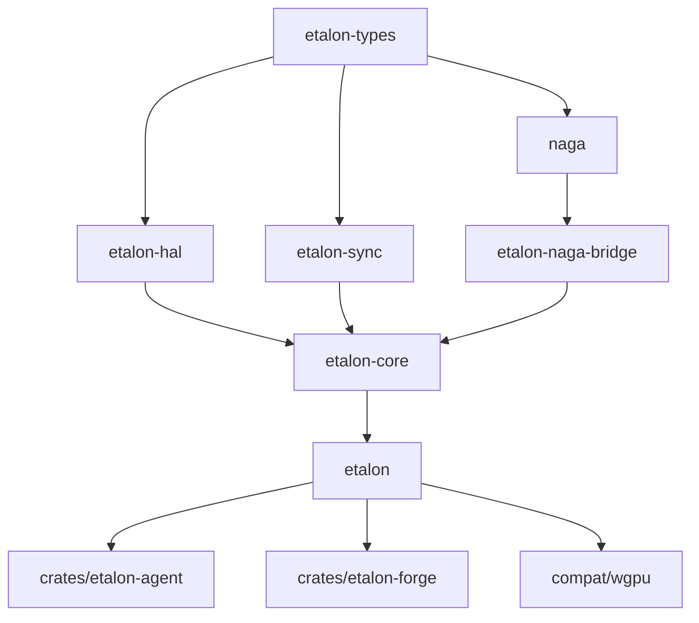

# Etalon Architectural Plan: Complete Codebase Rebranding & Modernization (`wgpu` → `etalon`)

> **Document ID:** `ETALON-PLAN-01`  
> **Status:** APPROVED FOR IMPLEMENTATION  
> **Author:** Timothy Charles Holborn & Antigravity  
> **Date:** October 2026  
> **Licensing Baseline:** Attribution-NonCommercial-NoDerivatives 4.0 International (CC BY-NC-ND 4.0)

---

## 1. Executive Intent & Architectural Objectives

The purpose of this refactor is the complete, unambiguous replacement of the `wgpu` nomenclature with **`etalon`** throughout this repository.

Standard `wgpu` is engineered primarily as a conservative, sandboxed WebGPU implementation designed for untrusted browser execution. In contrast, **Etalon** is engineered as a sovereign, high-throughput, silicon-level compute, graphics, and cognitive reasoning engine.

Retaining `wgpu` crate names, directory paths, and macro prefixes creates architectural confusion, invites accidental upstream collisions, and fails to communicate the radical shift toward zero-copy pointer access, hardware timeline semaphores, cooperative tensor arithmetic, and fiduciary execution enclaves.

### Core Objectives:

1. **Total Namespace Clarity**: Eliminate every vestige of `wgpu` across crate names, internal paths, symbol prefixes, and configuration flags.
2. **Directory & Workspace Structural Alignment**: Transition workspace folders (`wgpu/`, `wgpu-core/`, `wgpu-hal/`, etc.) into `etalon/`, `etalon-core/`, `etalon-hal/`, etc.
3. **Zero-Breakage Compatibility Shim**: Provide a lightweight `compat/wgpu` facade that re-exports `etalon`, ensuring external ecosystems (like [Aether](https://github.com/mediaprophet/rust-app-framework), [Webizen OS-Shell](https://github.com/WebizenAI/webizen-os-shell), and existing Qualia tools) can migrate at their own pace without cascading build failures.
4. **Preserved Upstream Ingestion Capability**: Maintain clean boundary mapping to ensure that critical driver fixes from upstream `gfx-rs/wgpu` can be translated and backported cleanly.

---

## 2. Comprehensive Crate & Namespace Renaming Matrix

Every crate in the workspace is assigned a distinct, authoritative Etalon identity:

| Current Crate Name       | Current Path              | New Crate Name                 | New Path                    | Role & Strategic Scope                                                            |
| :----------------------- | :------------------------ | :----------------------------- | :-------------------------- | :-------------------------------------------------------------------------------- |
| `wgpu-types`             | `wgpu-types/`             | **`etalon-types`**             | `etalon-types/`             | Fundamental types, 64-bit BDA descriptors, feature flags, device limits.          |
| `wgpu-sync`              | `wgpu-sync/`              | **`etalon-sync`**              | `etalon-sync/`              | Thread synchronization primitives, lock rank checking, epoch trackers.            |
| `wgpu-hal`               | `wgpu-hal/`               | **`etalon-hal`**               | `etalon-hal/`               | The Silicon Steward: Vulkan, Metal 3, DX12, GLES, and native CUDA driver backend. |
| `wgpu-naga-bridge`       | `wgpu-naga-bridge/`       | **`etalon-naga-bridge`**       | `etalon-naga-bridge/`       | Translation seam connecting Naga IR to Etalon pipeline layouts.                   |
| `wgpu-core`              | `wgpu-core/`              | **`etalon-core`**              | `etalon-core/`              | Resource state machine, validation, multi-queue dispatch, SnatchLock removal.     |
| `wgpu`                   | `wgpu/`                   | **`etalon`**                   | `etalon/`                   | Authoritative, idiomatic Rust API for graphics, AI compute, and tensor ops.       |
| `wgpu-info`              | `wgpu-info/`              | **`etalon-info`**              | `etalon-info/`              | CLI hardware introspection, warp geometry, and capability inspection.             |
| `wgpu-core-remote`       | `wgpu-core-remote/`       | **`etalon-core-remote`**       | `etalon-core-remote/`       | IPC serialization and out-of-process device execution.                            |
| `wgpu-core-remote-types` | `wgpu-core-remote-types/` | **`etalon-core-remote-types`** | `etalon-core-remote-types/` | Protocol serialization types for remote IPC.                                      |
| _(new)_                  | _(new)_                   | **`wgpu` (compat)**            | `compat/wgpu/`              | Thin compatibility shim re-exporting `etalon` for legacy callers.                 |

> **Note on Naga:**  
> The `naga` crate (`naga/`, `naga-types/`, `naga-cli/`) maintains its identity as the universal shader translation engine, but will be extended with Etalon-specific AST passes (for physical storage buffers, subgroup shuffles, and fiduciary capability manifests).

---

## 3. Systematic Dependency Order & Execution Steps

Renaming interdependent crates across a massive Cargo workspace requires strict topological ordering. The migration must execute from the foundation upwards:



### Phase 1: Foundational Types & Synchronization

1. **Rename Directories & Cargo.toml**:
   - `wgpu-types/` → `etalon-types/` (`name = "etalon-types"`, version `30.0.0`)
   - `wgpu-sync/` → `etalon-sync/` (`name = "etalon-sync"`, version `30.0.0`)
2. **Update Internal Type References**:
   - In `etalon-types`, update macro identifiers and crate documentation.
   - In `etalon-sync`, update internal imports from `wgpu_types` to `etalon_types`.
3. **Workspace Manifest Checkpoint 1**:
   - Update `[workspace.dependencies]` in root `Cargo.toml`:
     ```toml
     etalon-types = { version = "0.0.1", path = "./etalon-types" }
     etalon-sync = { version = "0.0.1", path = "./etalon-sync" }
     ```

### Phase 2: Hardware Abstraction Layer (`etalon-hal`)

1. **Directory & Manifest Rename**:
   - `wgpu-hal/` → `etalon-hal/` (`name = "etalon-hal"`)
2. **Dependency Re-linking**:
   - Point `Cargo.toml` dependencies to `etalon-types` and `etalon-sync`.
3. **Internal Code Adjustments**:
   - Replace `wgpu_types::` with `etalon_types::`.
   - Replace `wgpu_hal::` references in tests, benchmarks, and examples.
   - Update logging targets (`target: "etalon_hal"`).
4. **Validation Checkpoint 2**:
   - Run `cargo check -p etalon-hal` across Vulkan, DX12, and Metal.

### Phase 3: Naga Bridge & Core State Machine (`etalon-core`)

1. **Bridge Migration**:
   - `wgpu-naga-bridge/` → `etalon-naga-bridge/` (`name = "etalon-naga-bridge"`)
   - Re-link dependencies to `etalon-types` and `naga`.
2. **Core Migration**:
   - `wgpu-core/` → `etalon-core/` (`name = "etalon-core"`)
   - Update platform-specific dependency sub-crates:
     - `wgpu-core/platform-deps/windows` → `etalon-core/platform-deps/windows`
   - Replace internal references:
     - `wgpu_hal` → `etalon_hal`
     - `wgpu_types` → `etalon_types`
     - `wgpu_sync` → `etalon_sync`
     - `wgpu_naga_bridge` → `etalon_naga_bridge`
3. **Validation Checkpoint 3**:
   - Run `cargo check -p etalon-core`.

### Phase 4: Primary User-Facing API (`etalon`)

1. **Directory & Manifest Rename**:
   - `wgpu/` → `etalon/` (`name = "etalon"`)
2. **Public Re-Exports & Macros**:
   - In `etalon/src/lib.rs`:
     - Expose `pub use etalon_types as types;`
     - Re-export core abstractions cleanly.
   - Update web backend in `etalon/src/backend/webgpu.rs`.
3. **Documentation & Feature Attributes**:
   - Update `document-features` and feature flag docstrings.
4. **Validation Checkpoint 4**:
   - Run `cargo check -p etalon` on native desktop.
   - Run `cargo check -p etalon --target wasm32-unknown-unknown` on browser WASM.

### Phase 5: Auxiliary Crates, Tools, and Examples

1. **Auxiliary Crates**:
   - `wgpu-info/` → `etalon-info/`
   - `wgpu-core-remote/` → `etalon-core-remote/`
   - `wgpu-core-remote-types/` → `etalon-core-remote-types/`
2. **Examples & Benches**:
   - Update `Cargo.toml` in `examples/features/`, `examples/standalone/*`, and `benches/`.
   - Update import statements from `use wgpu::` to `use etalon::`.

### Phase 6: Compatibility Shim (`compat/wgpu`)

To prevent fracturing the broader ecosystem during this transition, create `compat/wgpu/`:

```toml
# compat/wgpu/Cargo.toml
[package]
name = "wgpu"
version = "0.0.1"
edition = "2021"
license-file = "../../LICENSE"

[dependencies]
etalon = { path = "../../etalon", default-features = false }

[features]
default = ["etalon/default"]
# Forward all features directly to etalon
std = ["etalon/std"]
webgpu = ["etalon/webgpu"]
vulkan = ["etalon/vulkan"]
metal = ["etalon/metal"]
dx12 = ["etalon/dx12"]
gles = ["etalon/gles"]
wgsl = ["etalon/wgsl"]
spirv = ["etalon/spirv"]
```

In `compat/wgpu/src/lib.rs`:

```rust
//! Backwards-compatibility facade for the legacy `wgpu` namespace.
//! Re-exports all primitives directly from `etalon`.

pub use etalon::*;
```

---

## 4. Symbol, Logging & Macro Translation Plan

| Context            | Legacy Identifier          | New Etalon Identifier        | Purpose                               |
| :----------------- | :------------------------- | :--------------------------- | :------------------------------------ |
| **Logger Target**  | `"wgpu"`                   | `"etalon"`                   | Filter tracing/logging output cleanly |
| **HAL Logger**     | `"wgpu_hal"`               | `"etalon_hal"`               | Hardware abstraction trace target     |
| **Core Logger**    | `"wgpu_core"`              | `"etalon_core"`              | Resource lifecycle and lock tracing   |
| **Lock Validator** | `cfg(wgpu_validate_locks)` | `cfg(etalon_validate_locks)` | Compile-time lock hierarchy checking  |
| **Shader Bridge**  | `wgpu_naga_bridge`         | `etalon_naga_bridge`         | AST to pipeline layout mapping        |
| **Global Structs** | `WgpuInstance`             | `EtalonInstance`             | Top-level host handle                 |
| **Error Enums**    | `WgpuError`                | `EtalonError`                | Core typed error representations      |

---

## 5. Verification Gateways

A phase is considered complete only when all the following gates pass without warnings or errors:

1. **Gate A: Cargo Check (Native Windows x86_64 MSVC)**:
   ```powershell
   cargo check -p etalon -p etalon-core -p etalon-hal -p etalon-types
   ```
2. **Gate B: Cargo Check (WebAssembly Browser Target)**:
   ```powershell
   cargo check -p etalon --target wasm32-unknown-unknown
   ```
3. **Gate C: Naga Test Suite (Shader Compilation Integrity)**:
   ```powershell
   cargo test -p naga
   ```
4. **Gate D: Etalon Core Unit Suite**:
   ```powershell
   cargo test -p etalon-core --lib
   ```
5. **Gate E: Downstream Compat Verification**:
   Verify that a test crate importing `wgpu` via `compat/wgpu` compiles identically.
