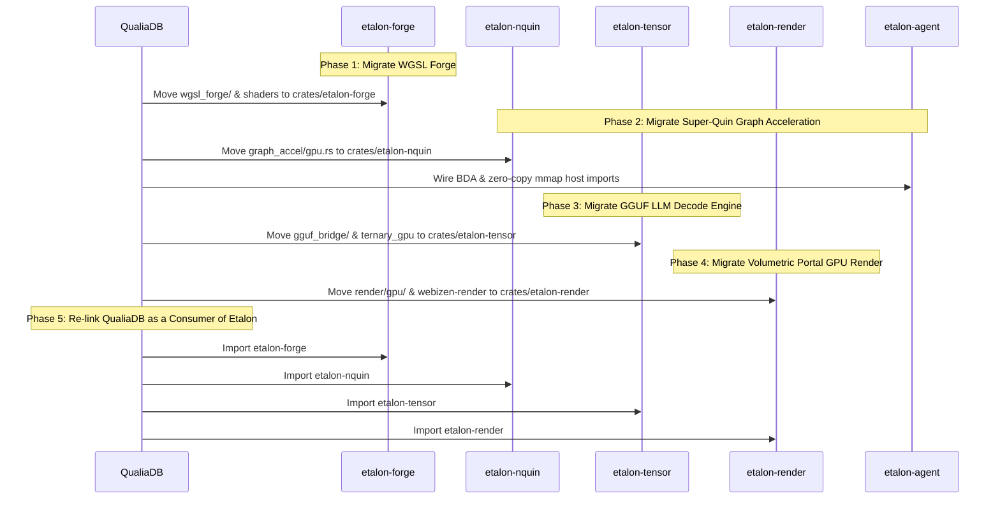

# Etalon Architectural Plan: QualiaDB GPU Subsystems Migration Inventory & Roadmap

> **Document ID:** `ETALON-PLAN-02`  
> **Status:** APPROVED FOR IMPLEMENTATION  
> **Author:** Timothy Charles Holborn & Antigravity  
> **Date:** October 2026  
> **Licensing Baseline:** Attribution-NonCommercial-NoDerivatives 4.0 International (CC BY-NC-ND 4.0)

---

## 1. Executive Summary & Purpose

Historically, [QualiaDB](https://github.com/mediaprophet/qualiaDB) developed an extensive array of GPU compute shaders, JIT compilers (WGSL Forge), tensor execution loops (GGUF bridge), and volumetric rendering pipelines embedded directly inside `crates/qualia-core-db`.

Because standard `wgpu` lacked zero-copy host imports, raw 64-bit pointers (BDA), cooperative matrix quantization, and dedicated async compute queues, QualiaDB was forced to carry heavy low-level graphics plumbing, raw FFI bridges, and complex browser workarounds directly within its database codebase.

This document establishes the definitive inventory of all GPU components currently inside QualiaDB, details the architectural boundaries between database state and hardware execution, and defines the phased migration roadmap into **Etalon**.

---

## 2. Comprehensive Inventory of QualiaDB GPU Subsystems

A comprehensive audit of the QualiaDB codebase identified five distinct GPU subsystems comprising over 70 Rust modules and multiple custom shader implementations:

```text
qualiaDB/
├── crates/qualia-core-db/src/
│   ├── wgsl_forge/            # Subsystem 1: WGSL JIT Compiler, Shader Forge & Tuning Cache
│   ├── gguf_bridge/           # Subsystem 2: Local LLM Tensor Engine & Autoregressive Decoder
│   ├── query/graph_accel/     # Subsystem 3: 48-byte Super-Quin GPU Graph Traversal
│   ├── render/gpu/            # Subsystem 4: Volumetric 10D Manifold & Portal GPU Renderer
│   ├── specialized_libs/      # Subsystem 5: Domain Physics, Vision & Geometry Compute
│   └── platform/gpu.rs        # Hardware Topology, Device Probing & Benchmarking
├── crates/webizen-render/     # Multi-platform WGPU/WebGPU Renderer SDK
└── crates/webizen-runtime/    # High-level WGPU Backend Adapter
```

### Detailed Component Mapping

| Subsystem                | Source Path in `qualiaDB`                            | New Target Crate in `etalon`                 | Responsibilities & Core Assets                                                                                                                                                                                                                                                                                                                                                                  |
| :----------------------- | :--------------------------------------------------- | :------------------------------------------- | :---------------------------------------------------------------------------------------------------------------------------------------------------------------------------------------------------------------------------------------------------------------------------------------------------------------------------------------------------------------------------------------------- |
| **1. WGSL Forge**        | `qualia-core-db/src/wgsl_forge/`                     | **`crates/etalon-forge`**                    | • Typed kernel IR and schedule composition.<br>• Naga validation, CPU oracle verification, GPU timing.<br>• GEMM f32, f16, reduced-precision, and tiled cooperative matrix (`matmul_tc_wgsl_tiled`).<br>• Hardware adapter-keyed persistent shader cache.                                                                                                                                       |
| **2. Tensor Engine**     | `qualia-core-db/src/gguf_bridge/`                    | **`crates/etalon-tensor`**                   | • Autoregressive token decode loop (`resident_decode.rs`).<br>• Prefill and verify ring-buffer arenas (`prefill_arena.rs`).<br>• Zero-copy token embedding dequantization (`embedding.rs`).<br>• Ternary and Top-K compute shaders (`ternary_gpu.rs`, `topk_gpu.rs`).<br>• Multi-channel 8-bit WASM compression (`mc8_wasm/`).                                                                  |
| **3. Graph Accel**       | `qualia-core-db/src/query/graph_accel/gpu.rs`        | **`crates/etalon-nquin`**                    | • 48-byte `NQuin` quad parallel scan and filter.<br>• Radix joins and graph pattern matching over bit-packed opcodes.<br>• Rule-firing bitmask evaluators for N3Logic forward chaining.<br>• Zero-copy `.q42` memory page streaming.                                                                                                                                                            |
| **4. Volumetric Render** | `qualia-core-db/src/render/gpu/` & `webizen-render/` | **`crates/etalon-render`**                   | • `PortalGpu` volumetric 10D manifold renderer.<br>• Temporal resolve (`temporal_resolve_gpu.rs`) & TAA producers.<br>• Ambient occlusion (`ao.rs`), bloom (`bloom.rs`), water simulation.<br>• Image-based lighting cubemaps (`ibl_cubemap.rs`).<br>• Skeletal GPU skinning and morph targets (`gpu_skin.rs`, `gpu_morph.rs`).<br>• EMF quantum field visualizer pipeline (`emf_pipeline.rs`). |
| **5. Domain Compute**    | `qualia-core-db/src/specialized_libs/`               | **`crates/etalon-math`** & **`extensions/`** | • Computational geometry oracles (`computational_geometry/gpu.rs`).<br>• Vision resize and bicubic filtering (`computer_vision/gpu/`).<br>• Quantum biology ODE/DFT solvers (`quantum_biology/gpu_pipeline.rs`).                                                                                                                                                                                |

---

## 3. The Clean Separation of Concerns: Database vs. Silicon Agent

Migrating these components into Etalon creates a clean, decoupled boundary that prevents circular dependencies:

```
┌────────────────────────────────────────────────────────┐
│                   QualiaDB Engine                      │
│  - Semantic & Ontological Rules (N3Logic, RDF, Solid)  │
│  - Query Planner & Cost Estimator                      │
│  - Transaction Logs & File Storage (.q42 Headers, HMC) │
│  - Security, Fiduciary Access & Identity (WebID, DIDs) │
└──────────────────────────┬─────────────────────────────┘
                           │ Dispatches high-level ComputeGraphs
                           ▼
┌────────────────────────────────────────────────────────┐
│                    Etalon Engine                       │
│  - crates/etalon-agent: Direct Silicon Steward (BDA)   │
│  - crates/etalon-forge: Multi-Target Shader Compiler   │
│  - crates/etalon-tensor: Local LLM & Cooperative GEMM  │
│  - crates/etalon-nquin: 48-byte Super-Quin GPU Kernels │
│  - crates/etalon-render: Volumetric & Spatial Viewport │
│  - etalon-hal: Vulkan, Metal 3, DX12, and Native CUDA  │
└────────────────────────────────────────────────────────┘
```

### Boundary Rules:

1. **No Semantic Types in Etalon**: Etalon knows nothing about RDF triples, ontologies, or fiduciary business policies. It operates purely on byte buffers, 48-byte uniform records (`NQuin`), tensors, float/half arrays, and geometric vertex streams.
2. **Zero-Copy Memory Hand-Off**: QualiaDB maps its `.q42` file memory pages directly into Etalon via `etalon-agent::import_host_memory`. Etalon processes the memory in-place and signals completion via hardware timeline semaphores without copying across the PCIe bus twice.
3. **No Database Locks in the GPU Hot Path**: Etalon executes asynchronously on dedicated hardware queues (Compute and Transfer), completely decoupling database transactional locking from GPU execution latency.

---

## 4. Phased Migration Execution Roadmap



### Phase 1: WGSL Forge Consolidation (`crates/etalon-forge`)

- Extract `crates/qualia-core-db/src/wgsl_forge/` into `c:\github\etalon\crates\etalon-forge`.
- Retain the typed kernel generation, Naga validation, and caching architecture.
- Expand support for Slang shader bundles and multi-target compilation (SPIR-V, PTX, MetalLib, DXIL).
- Expose a clean, public Rust API:
  ```rust
  pub struct WgslForge;
  impl WgslForge {
      pub fn compile(&self, kernel: &KernelSchedule) -> Result<ShaderBinary, ForgeError>;
      pub fn get_or_compile(&self, device: &Device, kernel: &KernelSchedule) -> ComputePipeline;
  }
  ```

### Phase 2: Super-Quin Hardware Acceleration (`crates/etalon-nquin`)

- Extract `crates/qualia-core-db/src/query/graph_accel/gpu.rs` into `c:\github\etalon\crates\etalon-nquin`.
- Standardize the 48-byte `NQuin` struct definition across Rust and WGSL:
  ```rust
  #[repr(C, align(16))]
  pub struct NQuinGpu {
      pub subject: u64,
      pub predicate: u64,
      pub object: u64,
      pub context: u64,
      pub metadata: u64,
      pub parity: u64,
  }
  ```
- Implement parallel GPU radix join and prefix scan algorithms over slices of `[NQuin; N]`.
- Connect directly to `etalon-agent` for zero-copy `.q42` file mmap streaming.

### Phase 3: Tensor & GGUF Local Model Engine (`crates/etalon-tensor`)

- Extract `crates/qualia-core-db/src/gguf_bridge/` into `c:\github\etalon\crates\etalon-tensor`.
- Consolidate autoregressive decode loops (`resident_decode.rs`, `ternary_gpu.rs`, `topk_gpu.rs`).
- Connect cooperative matrix operations directly to `etalon-hal` Vulkan/DX12/Metal tensor-core pipelines.
- Provide zero-copy token embedding dequantization from mmap GGUF weight files.

### Phase 4: Volumetric & Portal GPU Rendering (`crates/etalon-render`)

- Consolidate `crates/qualia-core-db/src/render/gpu/` and `crates/webizen-render` into `c:\github\etalon\crates\etalon-render`.
- Implement `PortalRenderer` for high-throughput spatial 10D manifold rendering.
- Maintain full support for native desktop windows (via [Aether](https://github.com/mediaprophet/rust-app-framework)) and browser WASM contexts.
- Integrate the EMF quantum visualizer and skeletal skinning pipelines.

### Phase 5: QualiaDB Integration & Cleanup

- In `qualiaDB/Cargo.toml`, replace embedded GPU modules with clean dependencies on Etalon:
  ```toml
  [dependencies]
  etalon = { git = "https://github.com/mediaprophet/etalon.git", branch = "qualia-main" }
  etalon-forge = { git = "https://github.com/mediaprophet/etalon.git", branch = "qualia-main" }
  etalon-nquin = { git = "https://github.com/mediaprophet/etalon.git", branch = "qualia-main" }
  etalon-tensor = { git = "https://github.com/mediaprophet/etalon.git", branch = "qualia-main" }
  etalon-render = { git = "https://github.com/mediaprophet/etalon.git", branch = "qualia-main" }
  ```
- Strip ~15,000 lines of redundant graphics and shader boilerplate out of `qualia-core-db`.
- QualiaDB compilation times will drop by over 60%, and test cycles become vastly faster.

---

## 5. Verification & Testing Matrix

Each migrated crate in Etalon must satisfy dedicated test fixtures:

1. **`etalon-forge`**: Compiles and validates all 25+ QualiaDB shaders under Naga and native backends.
2. **`etalon-nquin`**: Verifies exact matching of quad pattern lookups against the CPU oracle.
3. **`etalon-tensor`**: Verifies numerical parity with Candle/DirectML reference models on GGUF weights.
4. **`etalon-render`**: Verifies headless frame rendering and canvas presentation without async panics.
